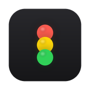
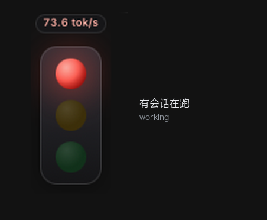
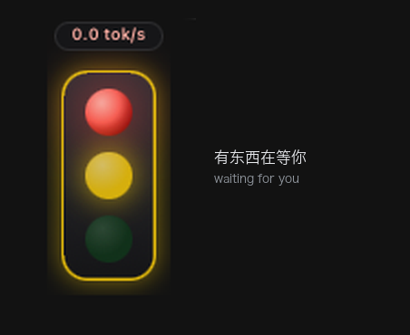
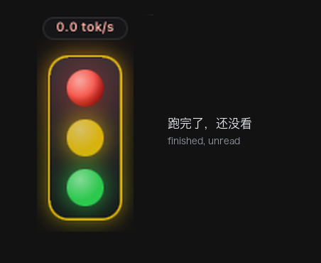

<div align="center">



# DSH Task Traffic Light

**A traffic light that runs on macOS: see whether each task is running, waiting for you, or already finished without switching back to DeepSeek Harness, then click a lit lamp to jump to that session.**

[](https://www.npmjs.com/package/dsh-task-traffic-light)
[](https://www.npmjs.com/package/dsh-task-traffic-light)
[](https://github.com/wunankun/dsh-task-traffic-light/actions/workflows/check.yml)
[](https://github.com/wunankun/dsh-task-traffic-light/releases/latest)
[](https://www.apple.com/macos/)
[](LICENSE)

[⬇️ Install](#install) · [🖼 Screenshots](#screenshots) · [🔒 Privacy](#privacy-and-security) · [⭐ Star the project](https://github.com/wunankun/dsh-task-traffic-light)

<sub>[简体中文](README.md) · **English** · [Español](README.es.md) · [日本語](README.ja.md) · [한국어](README.ko.md) · [MIT](LICENSE)</sub>

</div>

<div align="center">

</div>

Three things used to require switching back to DSH to check: a task still running, one blocked on your approval, one finished but unseen. Now they are a single glance at the edge of your screen — and one click takes you there.

---

## Three lamps, three facts

| Lamp | Lit while | Click it and it |
| :--: | --- | --- |
| 🔴 | **Red** · at least one top-level session is running | brings DSH forward and opens the **next** running session (each click moves on) |
| 🟡 | **Amber** · a session is waiting for your approval or answer | brings DSH forward and opens the **first** waiting session |
| 🟢 | **Green** · a session finished and DSH's unread dot is still there | brings DSH forward and opens the **oldest** finished one |

The lamps are independent: a run and a wait can light red and amber at the same time.

A few small things that matter every day:

- **Click a dark lamp** — or the empty edge of the panel — and it only brings DSH forward, without changing sessions.
- **The speed bar is optional**: menu bar icon → *Hide speed* / *Show speed*. The choice is remembered.
- **On launch** the three lamps light up one by one, then snap to the real state, so you know it is awake.
- **Sub-agents never light a lamp**: they have no row in DSH's list and cannot be opened, so they are excluded.
- **Drag it anywhere** — it stays there next time.

## Install

Three steps, two minutes. Requires DSH 0.2.1 or newer.

### 1 · Install the plugin

Inside DSH:

```sh
dsh plugin add dsh-task-traffic-light
```

Or install it from the plugin market / its plugin page. Refresh the page once afterwards.

### 2 · Install the app

The easy way: **Plugins → this plugin**. In the top right there is **Install the traffic light app**. One click downloads the release, unpacks it into `/Applications`, clears the quarantine flag and launches it.

After that the control follows the app's state: *Running* when it is open, *Open* when it is not, and when a new build exists a small *Update to v1.0.7* link appears under the button.

Prefer the terminal?

```sh
curl -fsSL https://raw.githubusercontent.com/wunankun/dsh-task-traffic-light/main/scripts/install-app.sh | sh
```

Or by hand: download `TaskTrafficLight.zip` from [Releases](https://github.com/wunankun/dsh-task-traffic-light/releases/latest), unzip it into Applications, and right-click → Open the first time (ad-hoc signed, not notarized).

### 3 · Let the two talk

Restart DSH, refresh the page, and drag the panel wherever it suits you.

**About updates**: only one thing needs your attention — the plugin. Once the app is installed, it swaps itself for the build bundled with the plugin on next launch. Machines that never installed it are never tempted.

## Screenshots

<table>
<tr>
<td align="center" width="33%"><br><sub>A session is running · red</sub></td>
<td align="center" width="33%"><br><sub>Something is waiting · amber</sub></td>
<td align="center" width="33%"><br><sub>Finished, unread · green</sub></td>
</tr>
</table>

## Privacy and security

**It works without a network.** The plugin and the app talk through a single JSON file on your Mac — no server, no account, no cloud.

| | In detail |
| --- | --- |
| **It reads** | The state of each top-level session in DSH: running / waiting / finished-unread. No message content, no files, no clipboard, no keystrokes. |
| **It writes** | `~/.dsh/task-traffic-light/state.json` (counts, session ids, speed) and a `focus.json` when you click a lamp. The app only stores its window position and toggles in `local.tasktrafficlight`. |
| **It connects** | **Zero requests** in normal use. Only when you press *Install / Update the app* does it download a zip from GitHub Releases. |
| **It never** | collects analytics, phones home, opens a port, uploads anything, or keeps remote logs. |

- All the code is in this repository: about 1,200 lines of plugin JavaScript (`index.js`, `client.js`) and about 740 lines of Swift (`macos/Sources`). No obfuscation, no minification, no prebuilt third-party binaries.
- Verify it yourself: the project contains exactly one outbound address, `APP_ZIP_URL` in `index.js`.
- Uninstalling the plugin also removes the app from `/Applications`, its preferences and its state file — no leftovers.

## How it works

```
DSH host plugin ──write──> ~/.dsh/task-traffic-light/state.json <──read── TaskTrafficLight.app
        ▲                                                                 │
        └────── /api/task-light/focus (authenticated, same-origin) ◀── focus.json ────────┘
```

1. Every half second the plugin writes a snapshot: running count, pending interactions, waiting session ids, finished-unread session ids, live speed.
2. The app polls that file and paints the lamps, so it goes dark by itself when DSH stops.
3. A click writes `focus.json`; the plugin confirms the target session still shows that lamp, then hands it to the front end over DSH's own local auth channel. The page acknowledges once it switches.
4. A click that is not acknowledged within 30 seconds expires silently, so nothing gets stuck.

<details>
<summary><b>Why the green lamp follows DSH's own unread dot</b></summary>

DSH already marks a session with a green dot when it finishes while you were not watching. The lamp is a mirror of that dot:

- while any session still has the dot, the lamp stays lit;
- open the session (by clicking the lamp or by yourself) and the lamp follows within a second;
- the lamp goes out only when the last dot is cleared.

With several unread sessions, each click opens the oldest and clears its dot, so clicking twice works through the queue.

One case DSH does not mark is covered here: **when the DSH window is not in front** (you switched apps, or the page was moved away), a session that finishes is treated as unread too, and the lamp lights. Switch back and that part clears itself.

</details>

<details>
<summary><b>Requirements and troubleshooting</b></summary>

- macOS 13 or newer, Apple Silicon or Intel (the release is universal).
- DSH 0.2.1 or newer, with the ability to add plugins to a profile.

**All lamps are dark.** If `state.json` has not changed for 10 seconds, the app assumes DSH is not running. Check that the plugin is enabled (`dsh plugin list`), then `tail -f ~/.dsh/task-traffic-light/state.json` and see whether it keeps updating.

**Nothing happens when I click.** Clicks are executed by the DSH page, so the page must have loaded the client half of the plugin — refresh once after installing. Clicks older than 30 seconds expire silently.

**A lamp is lit but nothing seems wrong.** Only top-level sessions count; sub-agents never light a lamp.

</details>

<details>
<summary><b>Build from source</b></summary>

```sh
git clone https://github.com/wunankun/dsh-task-traffic-light
cd dsh-task-traffic-light
./macos/build.sh          # builds a universal binary; requires the Xcode command line tools
open macos/TaskTrafficLight.app
```

</details>

## If this helped you

<div align="center">

No sponsors, no ads. If it saves you a few window switches,

[**give the project a star ⭐**](https://github.com/wunankun/dsh-task-traffic-light)

so more people running long DSH sessions can find it.

</div>

## License

MIT © 2026 wunankun
