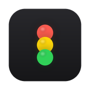
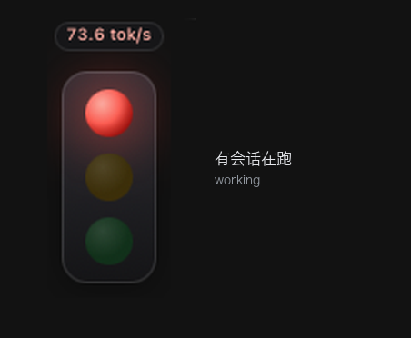
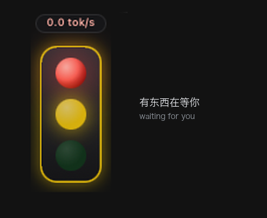
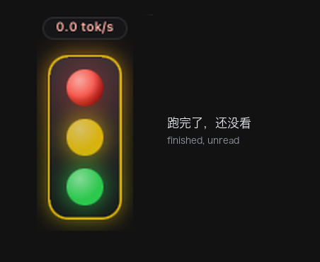

<div align="center">



# Semáforo de tareas de DSH

**Un semáforo que corre en macOS: mira si cada tarea sigue en marcha, te espera o ya terminó sin volver a DeepSeek Harness, y pulsa una luz encendida para ir a esa sesión.**

[](https://www.npmjs.com/package/dsh-task-traffic-light)
[](https://www.npmjs.com/package/dsh-task-traffic-light)
[](https://github.com/wunankun/dsh-task-traffic-light/actions/workflows/check.yml)
[](https://github.com/wunankun/dsh-task-traffic-light/releases/latest)
[](https://www.apple.com/macos/)
[](LICENSE)

[⬇️ Instalar](#instalación) · [🖼 Capturas](#capturas) · [🔒 Privacidad](#privacidad-y-seguridad) · [⭐ Danos una estrella](https://github.com/wunankun/dsh-task-traffic-light)

<sub>[简体中文](README.md) · [English](README.en.md) · **Español** · [日本語](README.ja.md) · [한국어](README.ko.md) · [MIT](LICENSE)</sub>

</div>

<div align="center">

</div>

Antes había que volver a DSH para saber tres cosas: si una tarea seguía en marcha, si te esperaba para aprobar algo, o si había terminado sin que la vieras. Ahora es un vistazo al borde de la pantalla, y un clic te lleva allí.

---

## Tres luces, tres cosas

| Luz | Encendida cuando | Al pulsarla |
| :--: | --- | --- |
| 🔴 | **Roja** · hay al menos una sesión de primer nivel en marcha | trae DSH al frente y abre la **siguiente** sesión en marcha (cada clic avanza) |
| 🟡 | **Ámbar** · una sesión espera tu aprobación o respuesta | trae DSH al frente y abre la **primera** que espera |
| 🟢 | **Verde** · una sesión terminó y el punto sin leer de DSH sigue ahí | trae DSH al frente y abre la **más antigua** |

Las luces son independientes: puede haber roja y ámbar a la vez.

Detalles que se agradecen a diario:

- **Pulsa una luz apagada** (o el borde vacío del panel) y solo trae DSH al frente, sin cambiar de sesión.
- **La barra de velocidad es opcional**: icono de la barra de menús → *Ocultar velocidad* / *Mostrar velocidad*; se recuerda.
- **Al arrancar**, las tres luces se encienden en orden y luego muestran el estado real.
- **Los subagentes nunca encienden una luz**: no tienen fila en DSH y no se pueden abrir.
- **Arrástralo donde quieras**: se queda ahí.

## Instalación

Tres pasos, dos minutos. Requiere DSH 0.2.1 o superior.

### 1 · Instala el plugin

Dentro de DSH:

```sh
dsh plugin add dsh-task-traffic-light
```

También desde el mercado de plugins o su página. Refresca la página una vez.

### 2 · Instala la app

Lo más fácil: **Plugins → este plugin**, arriba a la derecha **Instalar la app del semáforo**. Descarga la release, la descomprime en `/Applications`, quita la cuarentena y la abre.

Después el control sigue el estado de la app: *En marcha* si está abierta, *Abrir* si no, y si hay versión nueva aparece un pequeño enlace *Actualizar a v1.0.7*.

¿Prefieres la terminal?

```sh
curl -fsSL https://raw.githubusercontent.com/wunankun/dsh-task-traffic-light/main/scripts/install-app.sh | sh
```

O a mano: descarga `TaskTrafficLight.zip` desde [Releases](https://github.com/wunankun/dsh-task-traffic-light/releases/latest), descomprímelo en Aplicaciones y ábrelo con clic derecho → Abrir la primera vez (firma ad-hoc, sin notarizar).

### 3 · Conéctalos

Reinicia DSH, refresca la página y arrastra el panel donde te guste.

**Sobre las actualizaciones**: solo hay que actualizar el plugin. Una vez instalada, la app se reemplaza sola por la versión incluida en el plugin al arrancar.

## Capturas

<table>
<tr>
<td align="center" width="33%"><br><sub>En marcha · roja</sub></td>
<td align="center" width="33%"><br><sub>Te espera · ámbar</sub></td>
<td align="center" width="33%"><br><sub>Terminado · verde</sub></td>
</tr>
</table>

## Privacidad y seguridad

**Funciona sin red.** El plugin y la app hablan mediante un único archivo JSON en tu Mac: sin servidor, sin cuenta, sin nube.

| | En detalle |
| --- | --- |
| **Lee** | El estado de cada sesión de primer nivel de DSH: en marcha / esperando / terminada sin leer. No lee mensajes, archivos, portapapeles ni teclado. |
| **Escribe** | `~/.dsh/task-traffic-light/state.json` (recuentos, ids, velocidad) y un `focus.json` al pulsar una luz. La app solo guarda su posición y preferencias en `local.tasktrafficlight`. |
| **Se conecta** | **Cero peticiones** en uso normal. Solo al pulsar *Instalar / Actualizar la app* descarga un zip de GitHub Releases. |
| **Nunca** | recopila métricas, abre puertos, sube nada ni guarda registros remotos. |

- Todo el código está aquí: unas 1.200 líneas de JavaScript y unas 740 líneas de Swift. Sin ofuscación, sin minificación, sin binarios de terceros.
- Compruébalo: el proyecto tiene una sola dirección externa, `APP_ZIP_URL` en `index.js`.
- Al desinstalar el plugin se borran la app, sus preferencias y el archivo de estado.

## Cómo funciona

```
Plugin de DSH ──escribe──> ~/.dsh/task-traffic-light/state.json <──lee── TaskTrafficLight.app
        ▲                                                                 │
        └────── /api/task-light/focus (autenticado) ◀── focus.json ───────┘
```

1. Cada medio segundo el plugin escribe una instantánea: en marcha, pendientes, ids en espera, ids terminados sin leer y velocidad.
2. La app lo consulta y pinta las luces; si DSH se apaga, se apagan solas.
3. Al pulsar, la app escribe `focus.json`; el plugin confirma que esa sesión sigue mostrando esa luz y lo entrega al frontend por el canal local de DSH.
4. Un clic sin confirmar en 30 segundos caduca en silencio.

<details>
<summary><b>Por qué la luz verde sigue al punto de DSH</b></summary>

DSH ya marca con un punto verde las sesiones que terminan mientras no miras. La luz es el espejo de ese punto: se apaga cuando se limpia el último punto, y cada clic abre la más antigua. También cuenta el caso en que **la ventana de DSH no está al frente**: una sesión que termina entonces se considera sin leer.

</details>

<details>
<summary><b>Requisitos y problemas</b></summary>

- macOS 13 o superior, Apple Silicon o Intel (la release es universal).
- DSH 0.2.1 o superior, con capacidad de añadir plugins al perfil.

**Todo apagado.** Si `state.json` no cambia en 10 segundos, la app asume que DSH no está corriendo. Comprueba `dsh plugin list` y `tail -f ~/.dsh/task-traffic-light/state.json`.

**Al pulsar no pasa nada.** El clic lo ejecuta la página de DSH, así que debe haber cargado la mitad cliente del plugin: refresca una vez. Los clics de más de 30 segundos caducan.

</details>

<details>
<summary><b>Compilar desde el código</b></summary>

```sh
git clone https://github.com/wunankun/dsh-task-traffic-light
cd dsh-task-traffic-light
./macos/build.sh          # binario universal; requiere las herramientas de línea de comandos de Xcode
open macos/TaskTrafficLight.app
```

</details>

## Si te ha servido

<div align="center">

Sin patrocinadores ni anuncios. Si te ahorra unos cuantos cambios de ventana,

[**dale una estrella al proyecto ⭐**](https://github.com/wunankun/dsh-task-traffic-light)

para que más gente con sesiones largas de DSH lo encuentre.

</div>

## Licencia

MIT © 2026 wunankun
