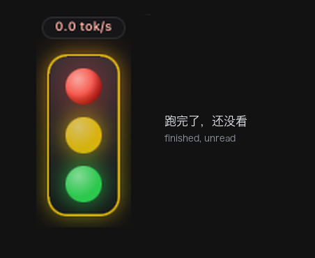

<div align="center">


# DSH タスク信号機

**macOS で動く信号機。DeepSeek Harness に戻らなくても、各タスクが実行中・返事待ち・完了のどれかが分かり、点いているランプをクリックすればそのセッションへ移動できます。**

[](https://www.npmjs.com/package/dsh-task-traffic-light)
[](https://www.npmjs.com/package/dsh-task-traffic-light)
[](https://github.com/wunankun/dsh-task-traffic-light/actions/workflows/check.yml)
[](https://github.com/wunankun/dsh-task-traffic-light/releases/latest)
[](https://www.apple.com/macos/)
[](LICENSE)

[⬇️ インストール](#インストール) · [🖼 スクリーンショット](#スクリーンショット) · [🔒 プライバシー](#プライバシーとセキュリティ) · [⭐ スターを付ける](https://github.com/wunankun/dsh-task-traffic-light)

<sub>[简体中文](README.md) · [English](README.en.md) · [Español](README.es.md) · **日本語** · [한국어](README.ko.md) · [MIT](LICENSE)</sub>

</div>

<div align="center">

</div>

実行中か、自分の返事待ちか、終わったのに見ていないか——以前は毎回 DSH に戻って確かめていました。いまは画面の端を一瞥するだけで分かり、クリックすればその場へ飛べます。

---

## 3 つのランプ、3 つのこと

| ランプ | 点くとき | クリックすると |
| :--: | --- | --- |
| 🔴 | **赤** · トップレベルのセッションが 1 つ以上実行中 | DSH を前面に出し、**次**の実行中セッションを開く（押すたびに順送り） |
| 🟡 | **黄** · 承認や回答を待っているセッションがある | DSH を前面に出し、**最初**の待機セッションを開く |
| 🟢 | **緑** · セッションが終わり、DSH の未読ドットがまだ残っている | DSH を前面に出し、**最も早く**終わったものを開く |

ランプは独立しています。実行中と待機が重なれば、赤と黄が同時に点きます。

日々効いてくる細かい仕様：

- **消えているランプ**やパネルの余白をクリックすると、セッションは変えずに DSH だけを前面に出します。
- **速度バーは任意**：メニューバーのアイコンから「速度表示を隠す / 表示する」。設定は記憶されます。
- **起動時**は 3 つのランプが順に点いてから実際の状態に戻ります。
- **サブエージェントはランプを点けません**：DSH の一覧に行がなく、開けないためです。
- **好きな場所にドラッグ**でき、次回もそこに居ます。

## インストール

3 ステップ、2 分。DSH 0.2.1 以降が必要です。

### 1 · プラグイン

DSH の中で：

```sh
dsh plugin add dsh-task-traffic-light
```

プラグイン市場やプラグインページからも入れられます。入れたらページを一度再読み込みしてください。

### 2 · アプリ

いちばん簡単なのは **プラグイン → このプラグイン** の右上にある「信号機アプリをインストール」。押すとリリースを取得し、`/Applications` に展開し、隔離属性を外して起動します。

その後はアプリの状態に追従します：起動中は「稼働中」、終了していれば「開く」、新しければボタンの下に小さく「v1.0.7 に更新」。

ターミナル派は：

```sh
curl -fsSL https://raw.githubusercontent.com/wunankun/dsh-task-traffic-light/main/scripts/install-app.sh | sh
```

手動でも可：[Releases](https://github.com/wunankun/dsh-task-traffic-light/releases/latest) から `TaskTrafficLight.zip` を取得し、アプリケーションフォルダへ。初回は右クリック → 開く（ad-hoc 署名、公証なし）。

### 3 · つなぐ

DSH を再起動し、ページを再読み込みし、パネルを好きな位置へ。

**更新について**：更新が必要なのはプラグインだけです。アプリは一度入れば、次回起動時にプラグイン同梱の版へ自動で入れ替わります。

## スクリーンショット

<table>
<tr>
<td align="center" width="33%"><br><sub>実行中 · 赤</sub></td>
<td align="center" width="33%"><br><sub>返事待ち · 黄</sub></td>
<td align="center" width="33%"><br><sub>完了・未読 · 緑</sub></td>
</tr>
</table>

## プライバシーとセキュリティ

**ネットワークなしでも動きます。** プラグインとアプリは Mac 上の 1 つの JSON ファイルだけでやり取りします。サーバーもアカウントもクラウドもありません。

| | 内容 |
| --- | --- |
| **読むもの** | DSH の各トップレベルセッションの状態（実行中 / 待機 / 完了・未読）だけ。会話内容、ファイル、クリップボード、キー入力は読みません。 |
| **書くもの** | `~/.dsh/task-traffic-light/state.json`（件数・セッション id・速度）と、クリック時の `focus.json`。アプリは位置と設定だけを `local.tasktrafficlight` に保存します。 |
| **通信** | 通常時は**ゼロ**。「アプリをインストール / 更新」を押したときだけ GitHub Releases から zip を取得します。 |
| **しないこと** | 解析、送信、ポート開放、アップロード、遠隔ログ。いずれもありません。 |

- コードはすべてこのリポジトリにあります：プラグイン約 1,200 行の JavaScript、アプリ約 740 行の Swift。難読化も圧縮も、同梱の第三者バイナリもありません。
- 外部アドレスは `index.js` の `APP_ZIP_URL` ひとつだけです。
- プラグインを削除すると、アプリ・設定・状態ファイルも一緒に消えます。

## 仕組み

```
DSH ホストプラグイン ──書く──> ~/.dsh/task-traffic-light/state.json <──読む── TaskTrafficLight.app
        ▲                                                                     │
        └────── /api/task-light/focus（認証つき・同一オリジン）◀── focus.json ──┘
```

1. プラグインは 0.5 秒ごとにスナップショットを書きます：実行数、保留中の操作、待機中の id、完了・未読の id、速度。
2. アプリはそのファイルを読んで描画するので、DSH が止まれば自然に暗くなります。
3. クリックするとアプリが `focus.json` を書き、プラグインが対象セッションを確認してから DSH のローカル認証経路でフロントエンドへ渡します。切り替わると同時に、会話は最新のメッセージまでスクロールします。
4. 30 秒以内に確認が取れないクリックは静かに破棄されます。

<details>
<summary><b>緑ランプが DSH の未読ドットに従う理由</b></summary>

DSH は「見ていない間に終わったセッション」に緑のドットを付けます。ランプはその鏡です。最後のドットが消えるまで点き続け、クリックのたびに最も早く終わったものを開きます。**DSH のウィンドウが前面にない**場合の完了も未読として扱います。

</details>

<details>
<summary><b>動作環境とトラブルシュート</b></summary>

- macOS 13 以降、Apple Silicon / Intel どちらでも（リリースは universal）。
- DSH 0.2.1 以降、プロファイルにプラグインを追加できること。

**全部消えている。** `state.json` が 10 秒更新されなければ DSH が動いていないと判断します。`dsh plugin list` と `tail -f ~/.dsh/task-traffic-light/state.json` を確認してください。

**クリックしても何も起きない。** クリックは DSH のページが実行するので、プラグインのクライアント側が読み込まれている必要があります。インストール後に一度再読み込みを。30 秒を超えたクリックは失効します。

</details>

<details>
<summary><b>ソースからビルド</b></summary>

```sh
git clone https://github.com/wunankun/dsh-task-traffic-light
cd dsh-task-traffic-light
./macos/build.sh          # universal をビルド。Xcode コマンドラインツールが必要
open macos/TaskTrafficLight.app
```

</details>

## 役に立ったら

<div align="center">

スポンサーも広告もありません。ウィンドウ切り替えが少しでも減ったら、

[**プロジェクトにスターを ⭐**](https://github.com/wunankun/dsh-task-traffic-light)

長い DSH セッションを回している人に届きます。

</div>

## ライセンス

MIT © 2026 wunankun
