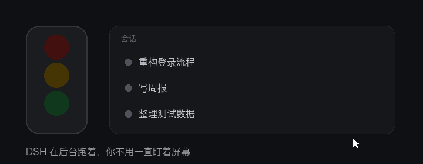

# DSH タスク信号機

macOS 版 [DeepSeek Harness](https://github.com/deepseek-ai/deepseek-harness) 用の浮かぶ信号機です。画面の端に置いておけば、ウィンドウを切り替えなくても、エージェントが今なにをしているか・どれが自分の返事を待っているかが分かります。



[简体中文](README.md) · [English](README.en.md) · [Español](README.es.md) · **日本語** · [한국어](README.ko.md) · [MIT](LICENSE)

## 三つの灯、三つの事実

| 灯 | 点いている条件 | クリックすると |
|---|---|---|
| 🔴 赤 | トップレベルのセッションが 1 つ以上動いている | DSH を前面に出し、**次に**動いているセッションを開く（クリックのたびに順に切り替わる） |
| 🟡 黄 | 承認または回答を待っているセッションがある | DSH を前面に出し、**最初に**待っているセッションを開く |
| 🟢 緑 | 終わったセッションの未読ドットが DSH に残っている | DSH を前面に出し、**最も古い**未読セッションを開く |

三つの灯は独立していて、赤と緑が同時に点くこともあります。そのとき操作できる灯はどれも、ポインタを乗せると指の形になります。

## インストール

**1 — プラグイン**（DSH の中）:

```sh
dsh plugin add dsh-task-traffic-light
```

アプリのプラグインマーケットから入れても構いません。入れたあとはたいていページの再読み込みが必要です。

**2 — アプリ本体:**

いちばん簡単なのは、DSH の **プラグイン → このプラグイン** を開いて **Install the lamp app** を押す方法です。プラグインが公開版をダウンロードし、`/Applications` に展開し、隔離属性を外して起動します。以後このボタンはアプリの状態に追随します——起動中は **Running v1.5**、終了すると **Start the lamp app**、新しい版が出ていれば **Update to v…**。ボタンの文言は英語と中国語のみです。

ターミナルから入れることもできます:

```sh
curl -fsSL https://raw.githubusercontent.com/wunankun/dsh-task-traffic-light/main/scripts/install-app.sh | sh
```

スクリプトは `TaskTrafficLight.app` を `/Applications` に入れて起動します。手動でも構いません。[Releases](https://github.com/wunankun/dsh-task-traffic-light/releases/latest) から `TaskTrafficLight.zip` を落として解凍し、アプリケーションフォルダにドラッグ、初回だけ右クリック →「開く」（ad-hoc 署名で、公証は受けていません）。

**3 — 完了。** DSH を再起動し、ページを再読み込みしてから、信号機を好きな場所に置いてください。ドラッグで移動でき、位置は記憶されます。

**アップデート。** 更新するものは 1 つだけ、プラグインです。アプリを一度入れておけば、次回起動時にプラグインが持っている版に置き換わります。入っていないアプリを勝手に入れることはありません——そこは常にクリックが必要です。

## 緑の灯が追うのは DSH の状態で、タイムスタンプではありません

DSH は「見ていないあいだに終わった」セッションの行に、小さな緑のドットを付けます。このアプリが描いているのは、そのドットそのものです。

- ドットが付いたセッションが 1 つでもあれば、灯は点いています。
- そのセッションを開くと（灯をクリックしても、他の方法でも）ドットが消え、灯も 1 秒以内に消えます。
- 最後のドットが消えてはじめて、緑の灯が消えます。

未読が複数あるときは、クリックのたびに最も古いものが開いて既読になるので、2 回クリックすれば小さな待ち行列を順に片づけられます。

DSH 自身は印を付けないケースもここで拾います。**DSH のウィンドウが手前にないとき**（別のアプリが前面、またはタブが隠れている）に選択中のセッションが終わると、未読として灯が点きます。DSH は「メインビューかどうか」しか見ず、ウィンドウが見えているかは判断しません。ウィンドウに戻るとこの分の通知は消えます。

## 仕組み

```
DSH Host プラグイン ──書き込み──> ~/.dsh/task-traffic-light/state.json <──読み込み── TaskTrafficLight.app
        ▲                                                                              │
        └────── /api/task-light/focus（認証付き・同一オリジン）◀── focus.json ──────────┘
```

- プラグインがスナップショットを書きます: 実行中の数、待っている操作、待機中セッションの id、未読セッションの id、トークン速度。
- アプリはそのファイルを一定間隔で読み、灯を描きます。
- クリックすると `focus.json` が書かれ、プラグインは「押された灯」に照らして対象を検証したうえで、DSH 自身のローカル認証チャネルで Web UI に渡します。ページはセッションを開き、要求に応答します。
- サブエージェントのセッションは除外されます。一覧に行がなく、開いても消せないので、灯を点けたままにできないようにしています。

## プライバシー

待ち受けポートはありません。プラグインは `~/.dsh/task-traffic-light/` に JSON を 1 つ書き、アプリは灯をクリックしたときにもう 1 つ書きます。それ以外で勝手に外へ出ることはありません。

唯一の例外はプラグイン詳細ページのインストールボタンです。押したときだけ GitHub から公開版をダウンロードし、OS 標準の `ditto`、`xattr`、`open` でアプリを配置します。それ以外では動かず、プラグインを外せばボタンごと消えます。全体で JavaScript 約 600 行、Swift 約 500 行——ひと息で読み通せる量です。

## 動作環境

- macOS 13 以降、Apple シリコンまたは Intel（公開版はユニバーサル）
- DeepSeek Harness 0.2.1 以降、プラグインを追加できるプロファイルがあること

アプリのメニューは今のところ中国語です。翻訳の PR はとても歓迎します。

## うまくいかないとき

**三つの灯がすべて消えている。** 10 秒以内に `state.json` が更新されていなければ「DSH が動いていない」と判断します。プラグインが有効か確認し（`dsh plugin list`）、`tail -f ~/.dsh/task-traffic-light/state.json` で更新を見てください。

**クリックしても何も起きない。** クリックを実行するのは DSH のページなので、プラグインのクライアント側が読み込まれたページが必要です。インストール後に一度ページを再読み込みしてください。30 秒を過ぎた要求は静かに失効します。

**灯は点いているのに何も起きていないように見える。** このプラグインはトップレベルのセッションだけを数えます。サブエージェントが単独で灯を点けることはありません。

## ソースからビルド

```sh
git clone https://github.com/wunankun/dsh-task-traffic-light
cd dsh-task-traffic-light
./macos/build.sh          # ユニバーサルバイナリ。Xcode のコマンドラインツールが必要
open macos/TaskTrafficLight.app
```

## ライセンス

MIT © 2026 wunankun
