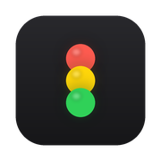
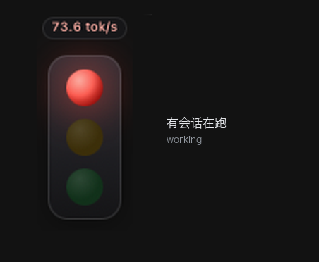
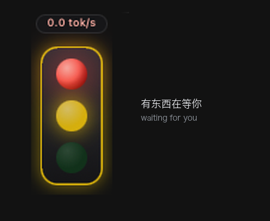
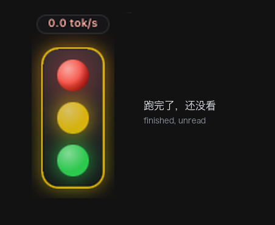

<div align="center">



# DSH 작업 신호등

**macOS에서 동작하는 신호등. DeepSeek Harness로 돌아가지 않아도 각 작업이 실행 중인지, 기다리는지, 끝났는지 알 수 있고, 켜진 램프를 클릭하면 해당 세션으로 이동합니다.**

[](https://www.npmjs.com/package/dsh-task-traffic-light)
[](https://www.npmjs.com/package/dsh-task-traffic-light)
[](https://github.com/wunankun/dsh-task-traffic-light/actions/workflows/check.yml)
[](https://github.com/wunankun/dsh-task-traffic-light/releases/latest)
[](https://www.apple.com/macos/)
[](LICENSE)

[⬇️ 설치](#설치) · [🖼 스크린샷](#스크린샷) · [🔒 개인정보 보호](#개인정보-보호와-보안) · [⭐ 스타 주기](https://github.com/wunankun/dsh-task-traffic-light)

<sub>[简体中文](README.md) · [English](README.en.md) · [Español](README.es.md) · [日本語](README.ja.md) · **한국어** · [MIT](LICENSE)</sub>

</div>

<div align="center">

</div>

실행 중인지, 내 응답을 기다리는지, 끝났는데 아직 안 봤는지 — 원래는 매번 DSH로 돌아가서 확인해야 했습니다. 이제는 화면 가장자리만 봐도 되고, 클릭 한 번이면 그 자리로 갑니다.

---

## 세 개의 램프, 세 가지 일

| 램프 | 켜지는 때 | 클릭하면 |
| :--: | --- | --- |
| 🔴 | **빨강** · 최상위 세션이 하나 이상 실행 중 | DSH를 앞으로 가져오고 **다음** 실행 중 세션을 엽니다 (누를 때마다 순환) |
| 🟡 | **노랑** · 승인이나 응답을 기다리는 세션이 있음 | DSH를 앞으로 가져오고 **첫 번째** 대기 세션을 엽니다 |
| 🟢 | **초록** · 세션이 끝났고 DSH의 안읽음 점이 아직 남아 있음 | DSH를 앞으로 가져오고 **가장 먼저 끝난** 세션을 엽니다 |

램프는 서로 독립적이라 실행 중과 대기가 겹치면 빨강과 노랑이 동시에 켜집니다.

매일 체감되는 작은 규칙들:

- **꺼진 램프**나 패널의 빈 가장자리를 클릭하면 세션은 바꾸지 않고 DSH만 앞으로 가져옵니다.
- **속도 막대는 선택 사항**: 메뉴 막대 아이콘 → *속도 숨기기* / *표시하기*, 설정은 기억됩니다.
- **시작할 때** 세 램프가 차례로 켜졌다가 실제 상태로 돌아옵니다.
- **서브에이전트는 램프를 켜지 않습니다**: DSH 목록에 행이 없고 열 수도 없기 때문입니다.
- **원하는 곳으로 드래그**하면 다음에도 그 자리에 있습니다.

## 설치

세 단계, 2분. DSH 0.2.1 이상이 필요합니다.

### 1 · 플러그인

DSH 안에서:

```sh
dsh plugin add dsh-task-traffic-light
```

플러그인 마켓이나 플러그인 페이지에서 설치해도 됩니다. 설치 후 페이지를 한 번 새로 고치세요.

### 2 · 앱

가장 쉬운 방법은 **플러그인 → 이 플러그인** 오른쪽 위의 **신호등 앱 설치**. 누르면 릴리스를 내려받아 `/Applications`에 풀고 격리 표시를 지운 뒤 실행합니다.

이후 버튼은 앱 상태를 따릅니다: 실행 중이면 *실행 중*, 꺼져 있으면 *열기*, 새 버전이 있으면 버튼 아래에 작은 *v1.0.7로 업데이트*.

터미널을 선호한다면:

```sh
curl -fsSL https://raw.githubusercontent.com/wunankun/dsh-task-traffic-light/main/scripts/install-app.sh | sh
```

수동 설치도 가능: [Releases](https://github.com/wunankun/dsh-task-traffic-light/releases/latest)에서 `TaskTrafficLight.zip`을 받아 응용 프로그램 폴더에 넣고, 처음 한 번만 우클릭 → 열기 (ad-hoc 서명, 공증 없음).

### 3 · 연결하기

DSH를 재시작하고 페이지를 새로 고친 뒤, 패널을 원하는 곳으로 옮기세요.

**업데이트에 대해**: 갱신할 것은 플러그인 하나뿐입니다. 앱은 한 번 설치되면 다음 실행 때 플러그인에 포함된 버전으로 스스로 교체됩니다.

## 스크린샷

<table>
<tr>
<td align="center" width="33%"><br><sub>실행 중 · 빨강</sub></td>
<td align="center" width="33%"><br><sub>응답 대기 · 노랑</sub></td>
<td align="center" width="33%"><br><sub>완료·안읽음 · 초록</sub></td>
</tr>
</table>

## 개인정보 보호와 보안

**네트워크 없이도 동작합니다.** 플러그인과 앱은 Mac 안의 JSON 파일 하나로만 대화합니다. 서버도, 계정도, 클라우드도 없습니다.

| | 내용 |
| --- | --- |
| **읽는 것** | DSH의 최상위 세션 상태(실행 중 / 대기 / 완료·안읽음)뿐입니다. 대화 내용, 파일, 클립보드, 키 입력은 읽지 않습니다. |
| **쓰는 것** | `~/.dsh/task-traffic-light/state.json`(개수·세션 id·속도)과 클릭 시 `focus.json`. 앱은 위치와 설정만 `local.tasktrafficlight`에 저장합니다. |
| **통신** | 평소에는 **요청 0건**. *앱 설치 / 업데이트*를 누를 때만 GitHub Releases에서 zip을 받습니다. |
| **하지 않는 것** | 분석, 전송, 포트 개방, 업로드, 원격 로그 — 전부 없습니다. |

- 코드는 모두 이 저장소에 있습니다: 플러그인 약 1,200줄 JavaScript, 앱 약 740줄 Swift. 난독화도 압축도, 미리 빌드된 서드파티 바이너리도 없습니다.
- 직접 확인하세요: 외부 주소는 `index.js`의 `APP_ZIP_URL` 하나뿐입니다.
- 플러그인을 제거하면 앱과 설정, 상태 파일도 함께 삭제됩니다.

## 동작 방식

```
DSH 호스트 플러그인 ──쓰기──> ~/.dsh/task-traffic-light/state.json <──읽기── TaskTrafficLight.app
        ▲                                                                     │
        └────── /api/task-light/focus (인증·동일 출처) ◀── focus.json ──────────┘
```

1. 플러그인은 0.5초마다 스냅숏을 씁니다: 실행 수, 대기 중 상호작용, 대기 세션 id, 완료·안읽음 id, 속도.
2. 앱은 그 파일을 읽어 램프를 그리므로 DSH가 멈추면 스스로 어두워집니다.
3. 클릭하면 앱이 `focus.json`을 쓰고, 플러그인이 해당 세션이 아직 그 램프인지 확인한 뒤 DSH의 로컬 인증 경로로 프런트엔드에 넘깁니다.
4. 30초 안에 확인되지 않은 클릭은 조용히 만료됩니다.

<details>
<summary><b>초록 램프가 DSH의 안읽음 점을 따르는 이유</b></summary>

DSH는 보지 않는 동안 끝난 세션에 초록 점을 붙입니다. 램프는 그 점의 거울입니다. 마지막 점이 사라질 때까지 켜져 있고, 클릭할 때마다 가장 먼저 끝난 세션을 엽니다. **DSH 창이 앞에 없을 때** 끝난 경우도 안읽음으로 처리합니다.

</details>

<details>
<summary><b>요구 사항과 문제 해결</b></summary>

- macOS 13 이상, Apple Silicon / Intel 모두 가능 (릴리스는 universal).
- DSH 0.2.1 이상, 프로필에 플러그인을 추가할 수 있어야 함.

**램프가 모두 꺼져 있음.** `state.json`이 10초 동안 갱신되지 않으면 DSH가 실행 중이 아니라고 판단합니다. `dsh plugin list`와 `tail -f ~/.dsh/task-traffic-light/state.json`을 확인하세요.

**클릭해도 반응이 없음.** 클릭은 DSH 페이지가 실행하므로 플러그인의 클라이언트 절반이 로드되어 있어야 합니다. 설치 후 한 번 새로 고치세요. 30초를 넘긴 클릭은 만료됩니다.

</details>

<details>
<summary><b>소스에서 빌드</b></summary>

```sh
git clone https://github.com/wunankun/dsh-task-traffic-light
cd dsh-task-traffic-light
./macos/build.sh          # universal 빌드, Xcode 명령 줄 도구 필요
open macos/TaskTrafficLight.app
```

</details>

## 도움이 되었다면

<div align="center">

후원도 광고도 없습니다. 창 전환이 조금이라도 줄었다면,

[**프로젝트에 스타를 ⭐**](https://github.com/wunankun/dsh-task-traffic-light)

긴 DSH 세션을 돌리는 더 많은 사람에게 닿을 수 있습니다.

</div>

## 라이선스

MIT © 2026 wunankun
