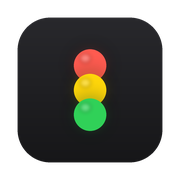
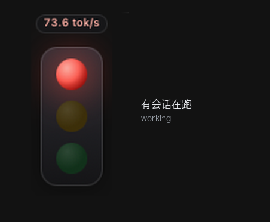
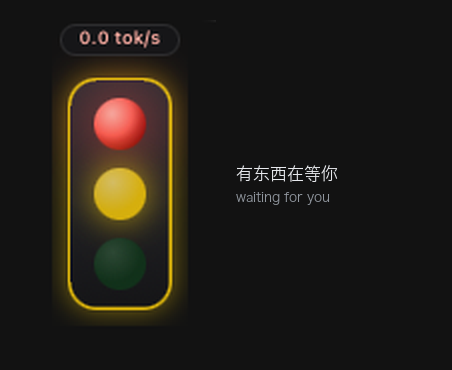
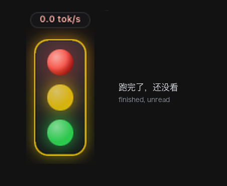

<div align="center">



# DSH 任务红绿灯

**运行在 macOS 上的红绿灯：不用切回 DeepSeek Harness，也能知道每个任务是在跑、在等你，还是已经跑完；点一下亮着的那盏灯，就回到对应会话。**

[](https://www.npmjs.com/package/dsh-task-traffic-light)
[](https://www.npmjs.com/package/dsh-task-traffic-light)
[](https://github.com/wunankun/dsh-task-traffic-light/actions/workflows/check.yml)
[](https://github.com/wunankun/dsh-task-traffic-light/releases/latest)
[](https://www.apple.com/macos/)
[](LICENSE)

[⬇️ 安装](#安装) · [🖼 看看它长什么样](#看看它长什么样) · [🔒 隐私与安全](#隐私与安全) · [⭐ 点个 Star](https://github.com/wunankun/dsh-task-traffic-light)

<sub>简体中文 · [English](README.en.md) · [Español](README.es.md) · [日本語](README.ja.md) · [한국어](README.ko.md) · [MIT](LICENSE)</sub>

</div>

<div align="center">

</div>

任务在跑、在等你确认、还是跑完了没看，这三件事本来都要切回 DSH 才知道。现在它们变成屏幕边上的一盏灯：一眼扫过去就明白，点一下就到现场。

---

## 三盏灯，三件事

| 灯 | 什么时候亮 | 点一下 |
| :--: | --- | --- |
| 🔴 | **红灯** · 至少有一个顶层会话在跑 | 把 DSH 带到最前，切到**下一个**在跑的会话（连续点就逐个循环） |
| 🟡 | **黄灯** · 有会话在等你批准或回答 | 把 DSH 带到最前，切到**第一个**在等的会话 |
| 🟢 | **绿灯** · 有会话跑完了，DSH 里那颗未读绿点还没消 | 把 DSH 带到最前，切到**最早完成**的那个 |

三盏灯互相独立：一边在跑、一边在等你，红黄就会同时亮。

还有几个不显眼但天天用得上的细节：

- **点一盏不亮的灯**，或者面板边缘的空白处，只把 DSH 叫到最前、不换会话。
- **速率条是可选的**：菜单栏图标里「隐藏速率显示 / 开启速率显示」，选择会记住。
- **启动时**三盏灯依次亮一遍，然后马上回到真实状态——你知道它醒了。
- **子代理不单独亮灯**：它们在 DSH 列表里没有行，点了也切不过去，所以永远不参与。
- **位置随意拖**，下次打开还在原地。

## 安装

三步，两分钟。需要 DSH 0.2.1 或更新。

### 第一步 · 装插件

在 DSH 里：

```sh
dsh plugin add dsh-task-traffic-light
```

也可以直接在插件的市场或插件页里点安装。装完刷新一次页面。

### 第二步 · 装小应用

最省事的做法：**插件 → 这个插件**，右上角有「安装红绿灯小应用」。点一下，它会下载发布包、解压进 `/Applications`、去掉隔离标记并启动。

之后那个位置会跟着小应用的状态走：开着显示「已开启」，关掉了变成「开启」，有新版本时只在按钮下面多一行小字「可更新 v1.0.7」。

不想点界面，也可以用命令：

```sh
curl -fsSL https://raw.githubusercontent.com/wunankun/dsh-task-traffic-light/main/scripts/install-app.sh | sh
```

想手动也行：去 [Releases](https://github.com/wunankun/dsh-task-traffic-light/releases/latest) 下载 `TaskTrafficLight.zip`，解压拖进「应用程序」，第一次右键 → 打开（ad-hoc 签名，没有公证）。

### 第三步 · 让两边说上话

重启 DSH、刷新页面，把灯拖到顺手的位置。

**关于更新**：只有一样东西需要你更新——插件。小应用装过一次之后，下次启动会自动换成插件里带的版本；没装过的机器不会自作主张装。

## 看看它长什么样

<table>
<tr>
<td align="center" width="33%"><br><sub>有会话在跑 · 红灯</sub></td>
<td align="center" width="33%"><br><sub>有东西在等你 · 黄灯</sub></td>
<td align="center" width="33%"><br><sub>跑完了还没看 · 绿灯</sub></td>
</tr>
</table>

## 隐私与安全

**它不联网也能用。** 插件和小应用之间只靠本机的一个 JSON 文件说话，没有服务器、没有账号、没有云端。

| | 具体是 |
| --- | --- |
| **它读** | DSH 里每个顶层会话的状态：在跑 / 在等 / 跑完未读。不读对话内容，不读文件，不读剪贴板，不读键盘。 |
| **它写** | `~/.dsh/task-traffic-light/state.json`（数量、会话 id、速度）和你点灯时的一份 `focus.json`；小应用只把窗口位置和开关存在 `local.tasktrafficlight`。 |
| **它连** | 平时**零请求**。只有你按下「安装 / 更新小应用」时，才会去 GitHub Releases 下载一次 zip。 |
| **它不做** | 没有统计、没有埋点、没有远程日志、不开任何端口、不上传任何东西。 |

- 全部代码就是这个仓库：插件 `index.js` + `client.js` 约 1200 行，小应用 `macos/Sources` 约 740 行 Swift。没有混淆、没有压缩、没有预编译的第三方二进制。
- 想自己核：整个项目只有一处对外地址，就是 `index.js` 里的 `APP_ZIP_URL`。
- 卸载插件时，`/Applications` 里的小应用、它的偏好和状态文件会一起被删掉，不留残渣。

## 它是怎么工作的

```
DSH Host 插件 ──写──> ~/.dsh/task-traffic-light/state.json <──读── TaskTrafficLight.app
        ▲                                                                 │
        └────── /api/task-light/focus（带认证、同源）◀── focus.json ────────┘
```

1. 插件每半秒写一份快照：在跑数量、待处理交互、等待中的会话 id、未读完成的会话 id、实时速度。
2. 小应用轮询这个文件画灯，所以 DSH 关掉时它会自己变黑。
3. 点击时小应用写 `focus.json`；插件先确认那个会话确实还亮着这盏灯，再通过 DSH 自己的本机认证通道交给前端；页面切过去后直接落回最新一条消息，再回执。
4. 点击 30 秒内没人确认就静默作废，避免误触。

<details>
<summary><b>绿灯为什么跟着 DSH 自己的绿点走</b></summary>

DSH 本来就会给「跑完了、但你当时没在看」的会话，在列表里标一颗绿点。红绿灯的绿灯就是这颗点的镜子：

- 只要还有会话带着绿点，灯就亮着；
- 你打开那个会话（点灯或者自己点都行），绿点一消，灯一秒内跟着灭；
- 最后一点消完，绿灯才灭。

有好几个没看的时候，每点一次切到最早完成、把它消掉，所以连点两下就是在排队处理。

还有一种 DSH 自己不会标的情况，这里补上了：**DSH 窗口不在前台时**（切到别的应用，或页面被切走），当前选中的那个会话跑完也算未读、灯会亮。等你把窗口切回前台，这部分提示会自动清掉。

</details>

<details>
<summary><b>环境要求与常见问题</b></summary>

- macOS 13 或更新，Apple 芯片或 Intel 都可以（发布包是 universal）。
- DSH 0.2.1 或更新，且能往 profile 里加插件。

**三盏灯全黑。** 10 秒内没更新过 `state.json` 就按「DSH 没在跑」处理。确认插件启用了（`dsh plugin list`），再 `tail -f ~/.dsh/task-traffic-light/state.json` 看看有没有在刷新。

**点了没反应。** 点击由 DSH 页面执行，所以页面必须加载到插件的客户端那一半——装完刷新一次页面即可。超过 30 秒的点击会静默过期。

**灯亮着但看着没事。** 插件只统计顶层会话，子代理不会单独点亮任何灯。

</details>

<details>
<summary><b>自己编译</b></summary>

```sh
git clone https://github.com/wunankun/dsh-task-traffic-light
cd dsh-task-traffic-light
./macos/build.sh          # 编 universal，需要 Xcode 命令行工具
open macos/TaskTrafficLight.app
```

</details>

## 如果它帮到了你

<div align="center">

没有赞助，也没有广告。如果它帮你少切了几次窗口，

[**给这个项目点个 Star ⭐**](https://github.com/wunankun/dsh-task-traffic-light)

能让更多在 DSH 里连轴转的人看到它。

</div>

## 许可证

MIT © 2026 wunankun
